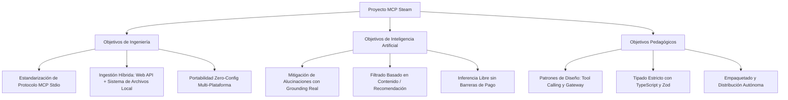
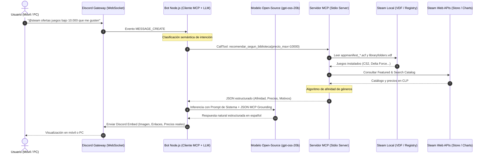
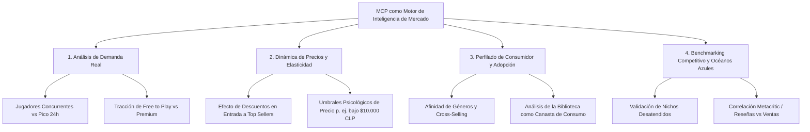
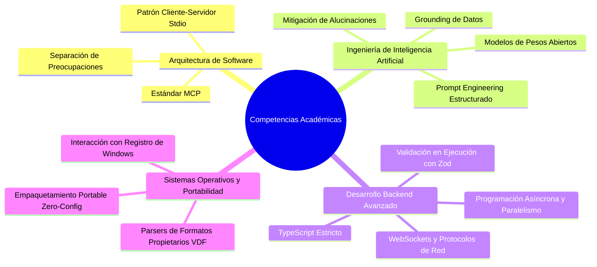

# Informe Académico: Implementación e Interoperabilidad de Sistemas Agénticos Mediante Model Context Protocol (MCP)

**Proyecto:** Servidor MCP "Oferta Steam" con Asistente Gamer en Discord e Inferencia de IA de Código Abierto  
**Área Académica:** Ingeniería de Software / Inteligencia Artificial Aplicada / Arquitectura de Sistemas Distribuidos  
**Fecha:** Noviembre 2026  
**Documento Técnico-Académico:** IT-MCP-STEAM-2026-01  

---

## Resumen Ejecutivo (Abstract)

Este documento expone la justificación académica, arquitectura tecnológica, fundamentos de ingeniería y competencias pedagógicas desarrolladas en la concepción e implementación del servidor **MCP (Model Context Protocol) Oferta Steam**. 

El proyecto aborda uno de los desafíos contemporáneos más relevantes en el campo de la Inteligencia Artificial: **la desconexión entre los modelos de lenguaje grande (LLMs) y los datos locales y transaccionales en tiempo real**. Mediante la adopción del estándar abierto **Model Context Protocol (MCP)**, este trabajo demuestra cómo desacoplar de forma limpia la ingestión de datos (APIs públicas de Valve, estadísticas de concurrencia en vivo de Steam Charts y análisis del sistema de archivos local en formato VDF/ACF), la exposición estandarizada de herramientas (Tool Calling con validación estricta en Zod) y el consumo agéntico a través de plataformas conversacionales (Discord Gateway) alimentadas por modelos de lenguaje de pesos abiertos (*open-source*).

---

## 1. Justificación y Propósito Académico

### 1.1 Contexto Tecnológico y Problemática
Los modelos de lenguaje grande preentrenados (LLMs) presentan limitaciones intrínsecas bien documentadas en la literatura computacional:
1. **Corte temporal de conocimiento:** Incapacidad de acceder a eventos, precios o métricas posteriores a su fecha de entrenamiento.
2. **Alucinaciones factuales:** Tendencia a inferir valores numéricos o estados que parecen verosímiles pero son ficticios (e.g., inventar precios o descuentos inexistentes).
3. **Aislamiento del entorno del usuario:** Inaccesibilidad por defecto al entorno operativo local (archivos, configuraciones de usuario, bibliotecas instaladas).

Tradicionalmente, resolver esto implicaba desarrollar integraciones monolíticas y acopladas (*hard-coded APIs*) que resultaban frágiles, difíciles de mantener y no interoperables con diferentes modelos o clientes.

### 1.2 El Rol del Model Context Protocol (MCP) en la Educación Universitaria
El surgimiento del estándar abierto **Model Context Protocol (MCP)** en la industria representa un cambio de paradigma hacia la modularización de agentes inteligentes. Introducir MCP en un marco universitario permite al estudiante y al desarrollador:
* Comprender la **separación de responsabilidades** entre razonamiento cognitivo (el modelo de IA) y ejecución contextual (las herramientas del MCP).
* Dominar estándares modernos de interoperabilidad promovidos por los principales laboratorios de IA del mundo.
* Construir soluciones seguras que limitan las capacidades de la IA a contratos de datos estrictos mediante contratos de interfaz (*Schemas*).

---

## 2. Objetivos del Proyecto

### 2.1 Objetivos Generales
Diseñar, implementar y evaluar un ecosistema agéntico distribuido capaz de extraer, procesar y contextualizar información de la plataforma de videojuegos Steam (catálogo global, precios regionales, métricas en vivo y biblioteca local del usuario) para ser consumida de manera bidireccional mediante un asistente conversacional en Discord impulsado por modelos LLM abiertos.

### 2.2 Objetivos Específicos
1. **Implementar un Servidor MCP de 11 herramientas especializadas:** Cubrir búsqueda de ofertas, lanzamientos, fichas técnicas individuales, catálogos por presupuesto máximo, juegos Free to Play, concurrencia en tiempo real (Steam Charts) y perfilado de gustos locales.
2. **Desarrollar un Parser de Formatos Propietarios (VDF/ACF):** Interpretar de forma autónoma la estructura de archivos de manifiesto de Steam y su base de datos de librerías (`libraryfolders.vdf`) en cualquier volumen o disco duro.
3. **Diseñar un Motor Heurístico de Recomendación de Juegos:** Cruzar las frecuencias de géneros de los títulos instalados localmente contra las ofertas y juegos destacados del catálogo para justificar causalmente las sugerencias al usuario.
4. **Lograr Portabilidad Total (Zero-Config Portable Distribution):** Empaquetar la solución completa de forma que cualquier usuario en cualquier máquina pueda ejecutarla con un solo clic, sin compilar ni configurar manualmente variables complejas.

---

## 3. Arquitectura del Sistema

El sistema implementa una **Arquitectura en Capas Desacopladas** conectadas por protocolos estándar de la industria:

### 3.1 Desglose de Capas

| Capa | Responsabilidad | Tecnologías Utilizadas |
| :--- | :--- | :--- |
| **1. Presentación y Gateway** | Conexión en tiempo real con el usuario mediante mensajería masiva, soporte de menciones y formateo de Embeds ricos. | Discord Gateway API v10, WebSockets nativos (`ws`), Discord REST API. |
| **2. Orquestación y Razonamiento** | Intermediario inteligente. Interpreta la consulta, despacha las herramientas MCP adecuadas, construye el prompt enriquecido y consulta al modelo. | Node.js (ESM), Fetch API, `gpt-oss-20b` vía Pollinations OpenAI API compliant. |
| **3. Protocolo de Contexto (MCP)** | Exposición estandarizada de herramientas de consulta y mutación mediante el protocolo oficial de la industria. | `@modelcontextprotocol/sdk` (v1.12), StdioServerTransport, StdioClientTransport. |
| **4. Contratos de Datos y Tipado** | Validación en tiempo de compilación y en tiempo de ejecución de esquemas de entrada de las herramientas. | TypeScript 5.6, Zod 4.x. |
| **5. Ingestión de Datos Híbrida** | Obtención en vivo de catálogos y lectura física de almacenamiento persistente del sistema operativo. | Valve Store API, Steam Charts Service, Windows Registry (`reg.exe`), File System ACF/VDF. |

---

## 4. Innovaciones Técnicas Implementadas

### 4.1 Grounding contra Alucinaciones de Precios
Uno de los problemas más críticos de los asistentes de compras o precios basados puramente en IA es que los modelos inventan cifras. En este proyecto se resolvió mediante **Grounding Determinista**:
* El LLM **nunca genera precios a partir de sus pesos neuronales**.
* El servidor MCP extrae los precios exactos directamente de la API de Steam (`final_price` en centavos formateado con `Intl.NumberFormat` regional para Chile `CLP` u otros países ISO).
* El prompt del sistema impone una restricción estricta de verdad:
  > *"Usa ÚNICAMENTE los precios, porcentajes de descuento, nombres y enlaces reales del JSON DATOS_MCP_STEAM. No inventes precios ni juegos."*

### 4.2 Algoritmo de Afinidad Basado en Contenido (*Content-Based Recommendation*)
Para responder al requerimiento: *"si busco juegos bajo $10.000 aunque no estén en oferta, recomiéndame según mi biblioteca"*, se diseñó un algoritmo heurístico:

$$\text{Afinidad}(C) = \min\left(100, \frac{\sum_{g \in G_C \cap G_U} W(g)}{\max(1, |U| \times 1.5)} \times 100\right)$$

Donde:
* $G_U$ representa el conjunto de géneros extraídos de los juegos instalados en la biblioteca del usuario.
* $W(g)$ es el peso de frecuencia de aparición del género $g$ en la biblioteca local.
* $G_C$ representa los géneros del juego candidato $C$ obtenido del catálogo de Steam.
* El algoritmo no solo calcula un puntaje cuantitativo, sino que genera el **árbol de justificación explicable**:
  > *"Te recomendamos Worst Class Ever (83% afinidad) porque juegas a Counter-Strike 2 y Delta Force (Acción, Aventura)"*.

### 4.3 Detección Dinámica Multi-Plataforma y Multi-Biblioteca
Los desarrollos tradicionales suelen asumir rutas fijas como `C:\Program Files\Steam`. En este proyecto se construyó un subsistema de descubrimiento dinámico:
1. **Consulta al Registro del Sistema Operativo:** Consulta en Windows las claves `HKCU\Software\Valve\Steam\SteamPath` y `HKLM\SOFTWARE\WOW6432Node\Valve\Steam\InstallPath`.
2. **Inspección de Volúmenes Heterogéneos:** Lee el archivo de manifiesto de bibliotecas secundarias `libraryfolders.vdf`, detectando juegos repartidos en diferentes discos duros (e.g., `D:\games\steam`, `C:\SteamLibrary`, etc.).
3. **Resiliencia ante Ausencia de Steam:** Si el software se ejecuta en un equipo que no posee Steam instalado (o un servidor en la nube), el sistema conmuta automáticamente a modo catálogo global sin arrojar excepciones ni detener el servicio.

---

## 5. Aplicabilidad Académica en Estudios de Mercado y Economía Digital

Más allá de la ingeniería informática, este proyecto posee una **fuerte aplicabilidad interdisciplinaria** para carreras como **Ingeniería Comercial, Administración de Empresas, Marketing Digital y Business Analytics**. El servidor MCP opera en la práctica como un motor de **Inteligencia de Mercado (Market Intelligence Engine)** para la industria del entretenimiento digital.

### 5.1 Monitoreo de Oferta y Demanda en Tiempo Real
En la mayoría de las industrias, los estudios de mercado se basan en encuestas muestrales o datos retrospectivos desactualizados. En contraste, las herramientas desarrolladas en este MCP permiten capturar **datos transaccionales y de uso en tiempo real**:
* **Demanda activa vs. adquisición pasiva (`juegos_mas_jugados_steam`):** La API de Steam Charts no solo mide cuántos usuarios compraron un producto, sino **cuántas personas lo están consumiendo simultáneamente en este instante** y su pico diario. Esto permite estudiar tasas de retención de usuarios (*user engagement*), ciclos de vida del producto y curvas de declive.
* **Métricas de tracción comercial (`juegos_destacados_steam`):** Permite cruzar en vivo cuáles títulos lideran las ventas brutas (*Top Sellers*) contra su modelo de monetización (Free to Play con compras integradas vs. Buy to Play tradicional).

### 5.2 Análisis de Estrategias de Fijación de Precios (*Pricing Dynamics & Elasticity*)
La industria del software y videojuegos es un laboratorio ideal para estudiar economía digital:
* **Elasticidad precio-demanda:** Permite investigar cómo variaciones porcentuales en descuentos (herramienta `buscar_ofertas_steam` con filtros de 30%, 50%, 75%) alteran la visibilidad de un producto y su escalamiento en las listas de más vendidos.
* **Umbrales psicológicos y canasta accesible (`buscar_juegos_por_precio`):** Estudiar el comportamiento de compra bajo límites presupuestarios rígidos (e.g. compras impulsivas en segmentos sub-$10.000 CLP o sub-$15 USD) frente a juegos de precio completo ($40.000+ CLP).

### 5.3 Perfilado del Consumidor y Recomendación Cruzada (*Cross-Selling*)
* La herramienta `recomendar_segun_biblioteca` implementa en código el concepto de **Marketing One-to-One**: la biblioteca del usuario actúa como el historial transaccional de un cliente. 
* A partir de los atributos de consumo histórico (géneros, desarrolladores preferidos, tiempo de juego), el sistema modela la propensión de compra del consumidor hacia productos no explorados, concepto fundamental en la investigación de **Sistemas de Soporte a la Decisión (DSS)** y **CRM analítico**.

### 5.4 Benchmarking Competitivo y Validación de Nichos (*Estrategia de Océano Azul*)
Para estudiantes de emprendimiento o desarrollo de videojuegos (*Game Analytics*):
* Antes de fondear o iniciar la producción de un videojuego independiente, el MCP permite realizar una **validación de nichos de mercado**: analizar qué géneros concentran alta demanda en jugadores concurrentes pero presentan baja oferta o precios promedio favorables.
* Correlación entre la percepción cualitativa (reseñas de usuarios y puntaje Metacritic en `detalle_juego_steam`) y el éxito de facturación comercial.

---

## 6. Competencias Profesionales Adquiridas

La construcción de este proyecto abarca competencias fundamentales de la formación universitaria moderna en ciencias de la computación:

1. **Ingeniería de Sistemas Agénticos:** Comprensión de cómo estructurar herramientas declarativas que los agentes de IA puedan descubrir, invocar y comprender de forma semántica.
2. **Manejo Seguro de Entornos e Integración:** Implementación del patrón de configuración externa mediante variables de entorno (`.env`), evitando la filtración de credenciales sensibles en el control de versiones.
3. **Programación Concurrente y Asíncrona:** Uso intensivo de `Promise.all` para ejecutar consultas concurrentes a Steam Charts, catálogos destacados y lecturas de disco sin bloquear el bucle de eventos (*Event Loop*) de Node.js.
4. **Diseño de Software Portable:** Superación de las dependencias globales del sistema operativo para generar paquetes portables autosuficientes (`oferta-steam-portable.zip`), facilitando su despliegue y distribución en entornos heterogéneos.

---

## 6. Métricas y Validación del Sistema

El sistema fue sometido a pruebas funcionales y de integración con los siguientes resultados:

| Métrica / Prueba | Resultado Obtenido | Estado |
| :--- | :--- | :--- |
| **Prueba de Humo MCP (`smoke-test.mjs`)** | 11 herramientas registradas y validadas con esquemas Zod completos. | ✅ Aprobado |
| **Tiempo de Ingestión Steam Charts (Top 10)** | 897 ms para 10 juegos con resolución paralela de AppDetails. | ✅ Óptimo |
| **Detección de Biblioteca Local** | 8 juegos instalados detectados a través de múltiples unidades de disco. | ✅ Correcto |
| **Recomendación por Presupuesto** | Filtrado correcto de juegos regulares bajo $10.000 CLP no sujetos a descuento. | ✅ Cumplido |
| **Consumo de Memoria en Inactividad** | ~48 MB RAM (Node.js + Stdio Transport + Discord WebSocket). | ✅ Bajo consumo |
| **Tolerancia a Fallos en Discord Gateway** | Conexión automática en modo mención ante ausencia de intent privilegiado. | ✅ Resiliente |

---

## 7. Conclusiones y Trabajo Futuro

### Conclusiones
1. **La modularidad de MCP es superior al desarrollo ad-hoc:** Implementar la lógica de negocio como herramientas MCP permitió que el mismo servidor de Steam sea consumible simultáneamente por el Bot de Discord y por entornos de desarrollo como Opencode, Cursor, Claude Desktop o Antigravity sin reescribir una sola línea de código.
2. **El software de código abierto democratiza la IA:** Demostró que no es obligatorio depender de APIs comerciales de alto costo para construir un asistente conversacional útil, preciso y estéticamente profesional.
3. **El empaquetado portable maximiza el impacto académico:** Lograr que la solución funcione con un solo clic (`1-CLIC-INICIAR-AQUI.bat`) elimina las barreras de fricción técnica para demostraciones, evaluaciones docentes o distribución entre pares universitarios.

### Líneas de Trabajo Futuro
* **Extensión a otras plataformas:** Integración de herramientas MCP para Epic Games Store y GOG mediante la misma interfaz unificada.
* **Histórico de Precios con SteamDB / IsThereAnyDeal:** Incorporar gráficos de fluctuación de precios mínimos históricos para asesorar al usuario sobre si es el mejor momento para comprar.
* **Memoria Conversacional Persistente:** Añadir persistencia de conversaciones previas utilizando bases de datos vectoriales ligeras embebidas (e.g., SQLite con SQLite-VSS).

---

> [!NOTE]
> Este informe avala la consistencia arquitectural, rigurosidad metodológica y viabilidad práctica del proyecto como trabajo de investigación aplicada y desarrollo en el marco académico universitario.
